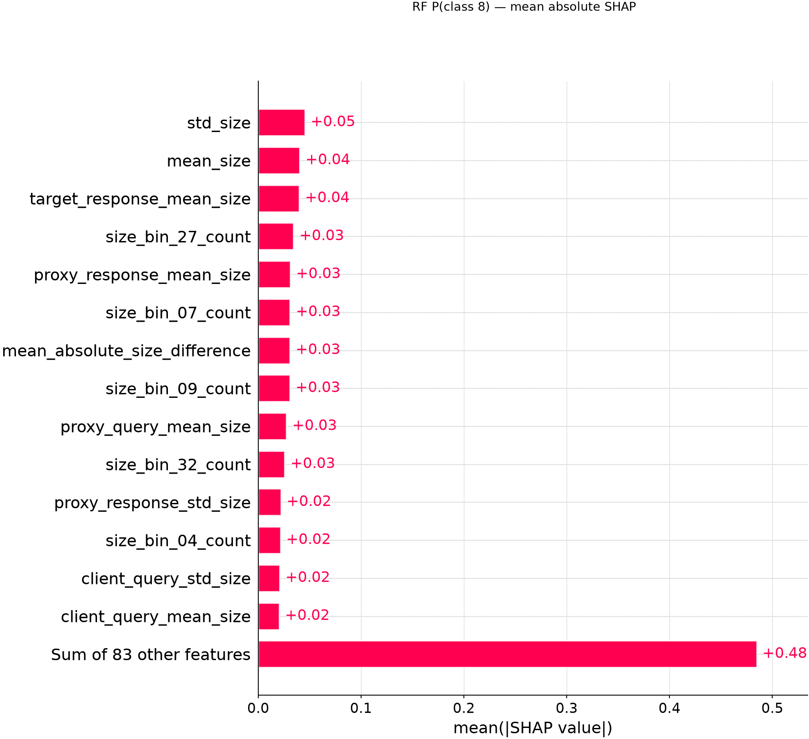
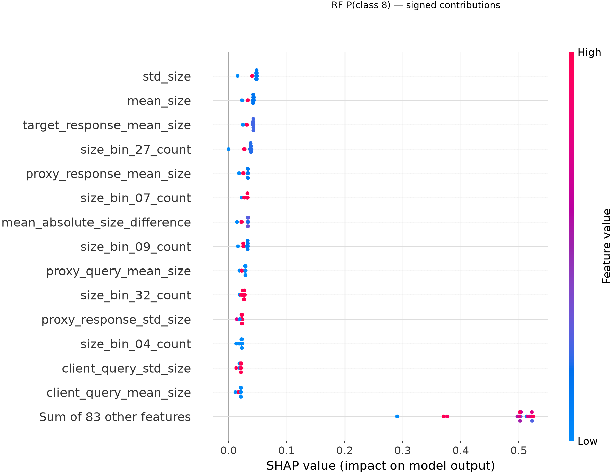
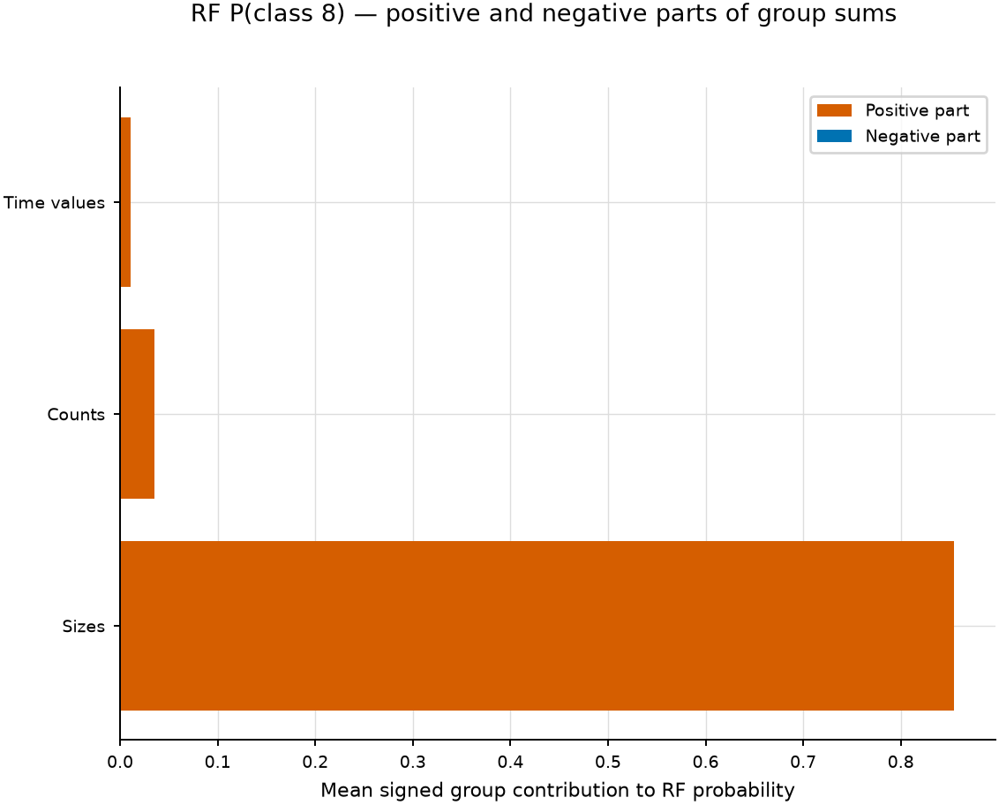
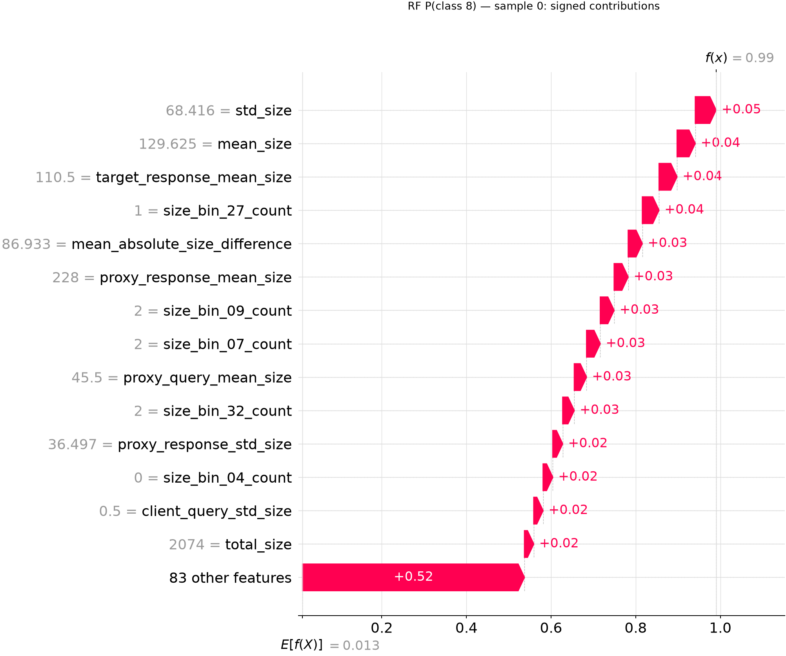
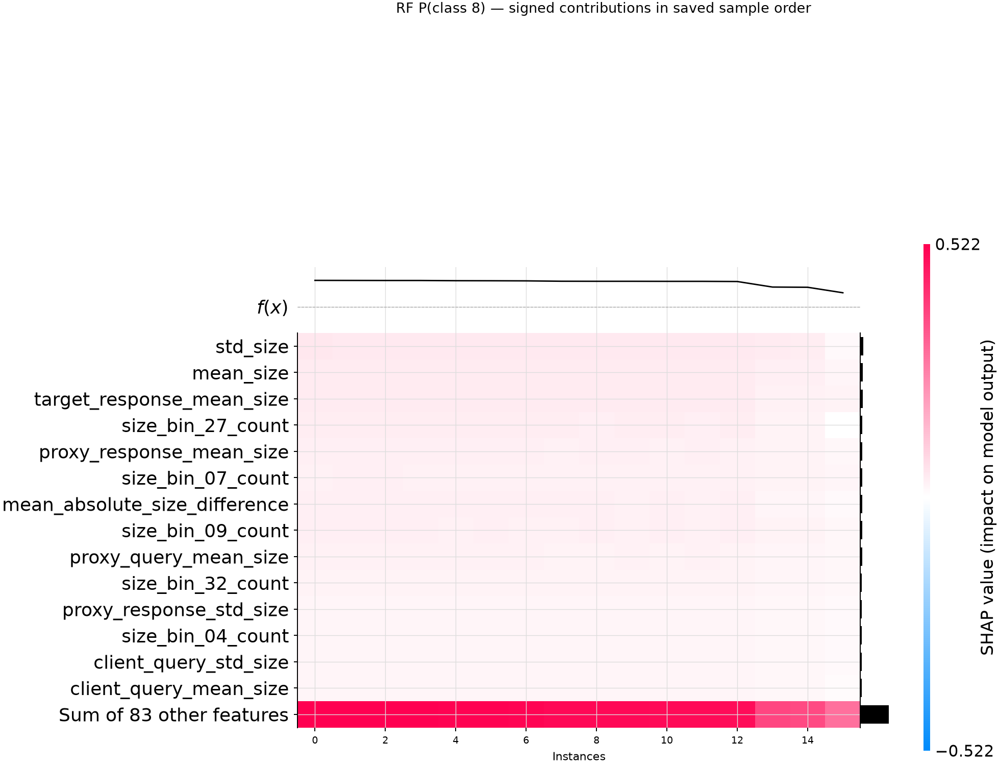
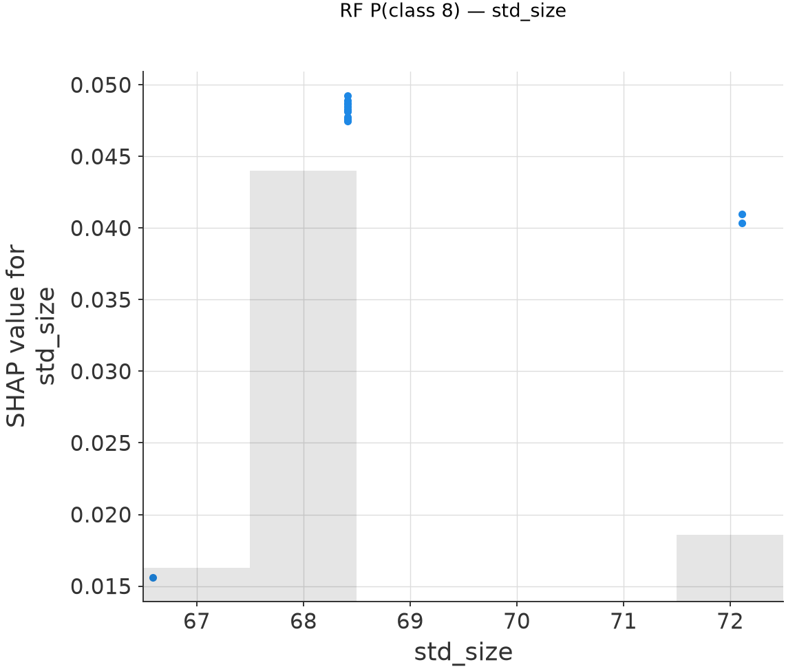

# Baseline RF TreeSHAP — instagram.com

This directory contains the TreeSHAP analysis of the final Random Forest
component of FOLD for the closed-world baseline configuration.

## Experiment

- Scenario: closed-world baseline
- Experiment ID: 1
- Seed: 59
- Dataset: `data/odoh_traces.csv`
- Random Forest test accuracy: **0.9887 (701/709)**
- Target class: **8 — `instagram.com`**
- Correctly classified target traces explained: **16**
- SHAP reference/background: **64 traces sampled from the training split**
- RF input dimension: **97 features**
- RF output classes: **100**

The explained samples belong to the original test split recorded in the
artifact manifest. The SHAP reference samples belong to the original training
split.

These explanations refer to the **Random Forest component only** and must not
be interpreted as explanations of the final FOLD `multi_output`.

## Saved attributions

The numerical SHAP results are stored in:

`rf_class_008_shap.npz`

The file contains the SHAP values, base value, RF probabilities, encoded
features, explained trace IDs, reference trace IDs, class names, feature names,
and metadata.

## Global feature importance

Mean absolute SHAP importance across the selected test traces:

## SHAP value distribution

The beeswarm shows both the magnitude and direction of the contributions:

## Semantic feature groups

Feature-level contributions aggregated into semantic RF feature groups:

## Local explanation

Waterfall explanation for the first selected `instagram.com` test trace:

## Heatmap

SHAP contributions across the selected test traces:

## Dependence plot

Dependence plot for the automatically selected relevant feature:

## Interpretation note

TreeSHAP attributes the Random Forest probability for class 8 to the 97 RF
input features. Several RF features are correlated or derived from the same
traffic measurements, so SHAP values are interpreted as model attributions
rather than independent causal effects on network traffic.

The main project objective remains the explanation of the final FOLD
`multi_output` through an end-to-end wrapper that recomputes all dependent
representations from the perturbed ODoH trace.
